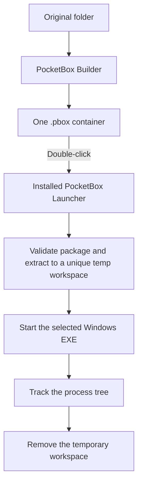
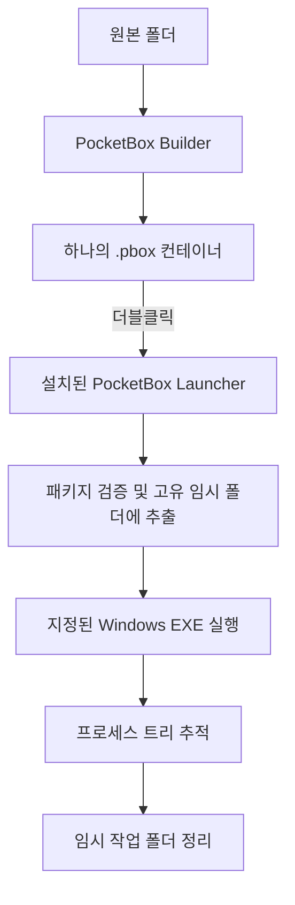

<div align="center">
  
  <h1>PocketBox</h1>
  <p><strong>One folder. One <code>.pbox</code> file. Double-click to launch.</strong></p>
  <p>
    <a href="https://github.com/5NN599/PocketBox/actions/workflows/tests.yml"></a>
    <a href="LICENSE"></a>
    
    
  </p>
  <p>
    <a href="#pocketbox-한국어">한국어</a> ·
    <a href="#overview">Overview</a> ·
    <a href="#quick-start">Quick start</a> ·
    <a href="#security">Security</a>
  </p>
</div>

PocketBox packages a folder of files into one `.pbox` container and launches a selected Windows program through a shared PocketBox launcher. Keep the original folder where it is, create a portable package file somewhere else, and open that package with a double-click.

> [!IMPORTANT]
> A `.pbox` file is a **data container**, not a standalone EXE. The PocketBox launcher must be installed on the Windows user account before `.pbox` files can be opened by double-clicking.

> [!WARNING]
> PocketBox is **not a security sandbox**. Programs launched from a package run with your normal Windows user permissions. Only open `.pbox` files from sources you trust.

## Table of contents

- [Overview](#overview)
- [Features](#features)
- [How it works](#how-it-works)
- [Quick start](#quick-start)
- [Create and open a package](#create-and-open-a-package)
- [Language support](#language-support)
- [Temporary workspace and saved data](#temporary-workspace-and-saved-data)
- [Security](#security)
- [Development and tests](#development-and-tests)
- [Project structure](#project-structure)
- [Roadmap](#roadmap)
- [FAQ](#faq)
- [Contributing and support](#contributing-and-support)
- [License](#license)

## Overview

PocketBox consists of two Windows applications:

| Application | Purpose |
|---|---|
| **PocketBox Builder** | Reads a source folder and creates a `.pbox` package at a separate output path. |
| **PocketBox Launcher** | Opens an associated `.pbox` file, validates and extracts its contents, then starts the configured EXE. |

### At a glance

| Capability | Current behavior |
|---|---|
| Package contents | Files, subfolders, and empty directories |
| Startup target | A selected Windows `.exe` inside the package |
| Original files | Preserved; packaging does not move or delete them |
| Container compression | Streaming zlib, one stream per file |
| Integrity | SHA-256 verification during extraction |
| Temporary files | Extracted to a unique workspace under the Windows temp directory |
| Cleanup | Best-effort cleanup after the tracked process tree exits |
| Interface language | English and Korean; English is the default |

## Features

- **One-file packaging** — bundle an application's EXE, DLLs, assets, configuration files, and subfolders into one `.pbox` file.
- **Choose the startup program** — select which EXE should run when the package is opened.
- **Keep the source untouched** — the Builder reads the original folder and writes a separate output package.
- **Shared launcher** — install PocketBox once per Windows user; packages do not each need a separate launcher EXE.
- **Double-click integration** — register `.pbox` with Windows Explorer for the current user.
- **Temporary workspace** — extract package contents to a unique temporary directory before launching the selected program.
- **Integrity checks** — validate paths and manifest values, check decompressed sizes, and verify SHA-256 hashes.
- **Bilingual interface** — switch the Builder and launcher messages between English and Korean.

## How it works



The `.pbox` file contains the packaged data and startup metadata. The shared launcher is installed separately and is registered as the current user's `.pbox` file handler.

## Quick start

### Requirements

- Windows 10 or Windows 11, 64-bit.
- Python 3.12, 64-bit, with the Python Launcher (`py`) for building from source.
- Internet access on the first build to install the Python dependencies.

> [!NOTE]
> Python is needed to **build** PocketBox from source. The generated `PocketBox.exe` and `PocketBoxBuilder.exe` are packaged with their runtime and do not need a separate Python installation to run. `build_all.bat` does not install Python itself.

### Build and install with one command

1. Install Python 3.12 (64-bit). Enable the Python Launcher and add Python to `PATH` during installation.
2. Clone or download this repository and extract it to a local folder.
3. Double-click **`build_all.bat`**.

Or clone it from PowerShell:

```powershell
git clone https://github.com/5NN599/PocketBox.git
cd PocketBox
.\build_all.bat
```

`build_all.bat` performs the first-run steps automatically:

1. Checks for Python 3.12 64-bit.
2. Creates or reuses the project-local `.venv` environment.
3. Installs the dependencies listed in `requirements.txt`.
4. Runs the unit tests and stops if they fail.
5. Builds `PocketBox.exe` and `PocketBoxBuilder.exe`.
6. Copies both executables to the repository root.
7. Installs the launcher for the current Windows user and registers the `.pbox` file association.

The final executables are placed in the **repository root**, not in a `dist` folder. The per-user installation does not require administrator rights. The first build needs internet access; later builds reuse the local environment.

### Build output

```text
PocketBox/
├── PocketBox.exe             # Shared .pbox launcher (generated)
├── PocketBoxBuilder.exe      # Package creation GUI (generated)
├── build_all.bat             # One-click setup, test, build, and install
├── pocketbox_builder.py      # Builder GUI source
├── pocketbox_runtime.py      # Launcher source
├── pocketbox_format.py       # .pbox container implementation
├── pocketbox_settings.py     # Language preference and message translation
├── requirements.txt
├── assets/
│   ├── pocketbox.ico
│   └── pbox_file.ico
├── docs/
│   └── PBOX_FORMAT.md
├── .venv/                    # Local build environment (generated)
└── build/                    # PyInstaller intermediate files (generated)
```

Generated EXEs, virtual environments, build files, and `.pbox` packages are excluded from Git by [`.gitignore`](.gitignore).

## Create and open a package

1. Launch `PocketBoxBuilder.exe`.
2. Select the source folder that contains the program EXE and all required files.
3. Choose the startup EXE from the detected executable list.
4. Choose an output path **outside** the source folder.
5. Click **Create .pbox**.
6. When creation finishes, double-click the new `.pbox` file in File Explorer.

> [!TIP]
> Keep the `.pbox` package and your original source folder in separate locations. The package stores a snapshot of the source files at the time it is created; later changes to the original folder are not automatically copied into an existing package.

### Original folder and package are separate

```text
D:\Games\MyGame\             # Original folder (left unchanged)
    Game.exe
    Assets\
    config.json

D:\Packages\MyGame.pbox      # New package created by Builder
```

The Builder does not delete, move, or rewrite the original files.

## Language support

The Builder starts in **English**. Use the language selector in the upper-right corner to switch to **한국어**. The selected language is saved for the current Windows user at:

```text
%APPDATA%\PocketBox\settings.json
```

The launcher uses the same preference for its message dialogs. If the settings file is missing or invalid, PocketBox falls back to English.

## Temporary workspace and saved data

When a `.pbox` package is opened, the launcher extracts its contents to a unique directory under the current user's Windows temporary directory. It starts the selected EXE from that workspace and tracks the launched process tree with a Windows Job Object. After the tracked process tree exits, PocketBox attempts to remove the workspace.

> [!WARNING]
> **Data saved inside the temporary workspace is temporary too.** Save files, settings, or other data written there by the launched application are removed when the workspace is successfully cleaned up.

For persistent data, the launched application should save to a durable user location such as `%APPDATA%`, `%LOCALAPPDATA%`, or the user's Documents folder.

Cleanup is best-effort. If PocketBox cannot verify that the tracked process tree has exited, or Windows keeps a file locked, it preserves the workspace rather than intentionally deleting files that may still be in use. The remaining path is reported to the user. Programs that deliberately leave the tracked Job Object, elevate privileges, install services or drivers, or create independent processes may not follow the normal cleanup lifecycle.

## Security

> [!CAUTION]
> **PocketBox does not isolate or sandbox the applications it launches.** A packaged program can access the files, registry, devices, and network resources available to your Windows account.

Current defensive checks include:

- Rejecting absolute paths, traversal components, Windows reserved device names, unsupported path characters, symbolic links, and Windows reparse points.
- Validating manifest entries, compressed-data ranges, declared uncompressed sizes, and zlib stream completion during extraction.
- Verifying each extracted file against its SHA-256 digest.

These checks help detect malformed packages and data corruption. They do **not** prove who created a package, provide a digital signature, or prevent a program from performing harmful actions after it starts. Only open packages from sources you trust.

For vulnerability reporting, see [SECURITY.md](SECURITY.md).

## Development and tests

The unit tests use Python's standard `unittest` framework. Run them with Python 3.12 or newer:

```powershell
py -3.12 -m unittest discover -v
```

To create a local environment and install the build dependencies manually:

```powershell
py -3.12 -m venv .venv
.venv\Scripts\python.exe -m pip install -r requirements.txt
.venv\Scripts\python.exe -m unittest discover -v
```

GitHub Actions runs the unit tests on Windows and Ubuntu for pushes and pull requests. These tests cover the container format and language settings; they do not replace validation of Windows-specific EXE building, Explorer file association, icon refresh, or process-tree cleanup on a real Windows 10/11 machine.

## Project structure

| Path | Description |
|---|---|
| `pocketbox_builder.py` | PySide6 GUI for creating `.pbox` packages |
| `pocketbox_runtime.py` | Shared launcher entry point |
| `pocketbox_format.py` | Container layout, zlib compression, path validation, extraction, and hashing |
| `pocketbox_settings.py` | Per-user language preference and translated diagnostics |
| `test_format.py` | Container format tests |
| `test_settings.py` | Settings and diagnostic translation tests |
| `build_all.bat` | One-click setup, tests, EXE build, and per-user installation |
| `install_pocketbox.bat` | Install launcher and register `.pbox` file association |
| `uninstall_pocketbox.bat` | Remove per-user registration and installed application files |
| `docs/PBOX_FORMAT.md` | Version 1 `.pbox` binary format notes |
| `.github/workflows/tests.yml` | Cross-platform unit-test workflow |

## Roadmap

- [x] Create a single `.pbox` container from a folder.
- [x] Select the Windows EXE launched by a package.
- [x] Preserve the original folder during package creation.
- [x] Register a shared launcher for `.pbox` files per Windows user.
- [x] Add English and Korean Builder UI and launcher messages.
- [x] Add package path validation and SHA-256 verification.
- [ ] Publish signed Windows release binaries.
- [ ] Expand Windows integration testing across more application types.
- [ ] Publish a formal long-term compatibility policy for the `.pbox` format.

## FAQ

<details>
  <summary><strong>Is a .pbox file itself an executable?</strong></summary>
  <p>No. A <code>.pbox</code> file is a data container. Install the PocketBox launcher on the Windows user account first; after the file association is registered, double-clicking a package opens it with PocketBox.</p>
</details>

<details>
  <summary><strong>Does package creation modify or delete my original files?</strong></summary>
  <p>No. The Builder reads the selected source folder and writes a separate output package. It does not move or delete the source files.</p>
</details>

<details>
  <summary><strong>Will save files created by the packaged program remain?</strong></summary>
  <p>Not when they are written inside the temporary workspace. The workspace is cleaned up after the tracked process tree exits. The packaged application should save persistent data under a durable user folder such as <code>%APPDATA%</code> or <code>%LOCALAPPDATA%</code>.</p>
</details>

<details>
  <summary><strong>Is PocketBox a sandbox or antivirus?</strong></summary>
  <p>No. It packages and launches programs; it does not isolate them or prevent malicious behavior. A launched program has the permissions of the current Windows user.</p>
</details>

<details>
  <summary><strong>Does PocketBox aim to beat 7-Zip compression ratios?</strong></summary>
  <p>No. The current format uses streaming zlib compression and focuses on bundling files with a configured startup program. It is not designed as a high-ratio replacement for specialist archivers.</p>
</details>

<details>
  <summary><strong>How do I uninstall PocketBox?</strong></summary>
  <p>Run <code>uninstall_pocketbox.bat</code> from the project folder. It removes the current user's file association and installed PocketBox files. It does not delete your source folders or existing <code>.pbox</code> packages.</p>
</details>

## Contributing and support

Contributions, bug reports, and feature suggestions are welcome. Please read:

- [Contributing guide](CONTRIBUTING.md)
- [Code of conduct](CODE_OF_CONDUCT.md)
- [Security policy](SECURITY.md)
- [Support guide](SUPPORT.md)

Use the [issue tracker](https://github.com/5NN599/PocketBox/issues) for reproducible bugs and feature requests. Do not post private vulnerability details in public issues.

## License

PocketBox is released under the [MIT License](LICENSE).

---

# PocketBox (한국어)

<div align="center">
  <p><strong>폴더 하나. <code>.pbox</code> 파일 하나. 더블클릭으로 실행.</strong></p>
  <p>
    <a href="https://github.com/5NN599/PocketBox/actions/workflows/tests.yml"></a>
    <a href="LICENSE"></a>
    
    
  </p>
</div>

PocketBox는 여러 파일과 폴더를 하나의 `.pbox` 컨테이너로 묶고, 공용 PocketBox 런처를 통해 지정한 Windows 프로그램을 실행하는 도구입니다. 원본 폴더는 그대로 보존하고, 다른 위치에 패키지 파일을 만든 다음 더블클릭으로 열 수 있습니다.

> [!IMPORTANT]
> `.pbox` 파일은 **데이터 컨테이너**이며 단독 실행 EXE가 아닙니다. 더블클릭 실행을 사용하려면 Windows 사용자 계정에 PocketBox 런처를 먼저 설치해야 합니다.

> [!WARNING]
> PocketBox는 **보안 샌드박스가 아닙니다.** 패키지 안에서 실행되는 프로그램은 현재 Windows 사용자와 동일한 권한으로 동작합니다. 신뢰할 수 있는 출처의 `.pbox` 파일만 실행하세요.

## 목차

- [개요](#개요)
- [주요 기능](#주요-기능)
- [작동 방식](#작동-방식)
- [빠른 시작](#빠른-시작)
- [패키지 생성 및 실행](#패키지-생성-및-실행)
- [언어 지원](#언어-지원)
- [임시 작업 폴더와 데이터 저장](#임시-작업-폴더와-데이터-저장)
- [보안](#보안)
- [개발 및 테스트](#개발-및-테스트)
- [프로젝트 구조](#프로젝트-구조)
- [로드맵](#로드맵)
- [자주 묻는 질문](#자주-묻는-질문)
- [기여 및 지원](#기여-및-지원)
- [라이선스](#라이선스)

## 개요

PocketBox는 두 개의 Windows 프로그램으로 구성됩니다.

| 프로그램 | 역할 |
|---|---|
| **PocketBox Builder** | 원본 폴더를 읽어 별도 위치에 `.pbox` 패키지를 생성합니다. |
| **PocketBox Launcher** | 연결된 `.pbox` 파일을 열고, 내용을 검증·추출한 다음 지정된 EXE를 실행합니다. |

### 핵심 동작

| 항목 | 현재 동작 |
|---|---|
| 패키지 구성 | 파일, 하위 폴더 및 빈 디렉터리 |
| 시작 프로그램 | 패키지 안에서 선택한 Windows `.exe` |
| 원본 파일 | 이동하거나 삭제하지 않고 보존 |
| 컨테이너 압축 | 파일별 스트리밍 zlib 압축 |
| 무결성 검사 | 추출 중 SHA-256 검사 |
| 임시 파일 | Windows 임시 폴더 아래에 고유 작업 폴더 생성 |
| 정리 | 추적 중인 프로세스 트리 종료 후 최선형 정리 |
| 인터페이스 | 영어와 한국어 지원, 기본 언어는 영어 |

## 주요 기능

- **단일 파일 패키징** — 프로그램 EXE, DLL, 리소스, 설정 파일과 하위 폴더를 하나의 `.pbox`로 묶습니다.
- **시작 프로그램 지정** — 패키지를 열었을 때 실행할 EXE를 선택합니다.
- **원본 보존** — Builder는 원본 폴더를 읽고 별도의 결과 패키지를 생성합니다.
- **공용 런처** — Windows 사용자별로 PocketBox를 한 번 설치하면 패키지마다 별도의 런처 EXE를 만들 필요가 없습니다.
- **더블클릭 연결** — 현재 사용자 계정의 Windows 탐색기에 `.pbox` 파일 연결을 등록합니다.
- **임시 작업 공간** — 지정된 프로그램을 실행하기 전에 패키지 내용을 고유한 임시 폴더에 추출합니다.
- **무결성 검사** — 경로와 매니페스트 값, 압축 해제 크기 및 SHA-256 해시를 검사합니다.
- **한국어/영어 UI** — Builder와 런처 안내 문구를 영어와 한국어로 전환할 수 있습니다.

## 작동 방식



`.pbox` 파일에는 패키징된 데이터와 시작 프로그램 정보가 포함됩니다. 공용 런처는 별도로 설치되며 현재 Windows 사용자 계정의 `.pbox` 파일 연결에 등록됩니다.

## 빠른 시작

### 요구 사항

- Windows 10 또는 Windows 11, 64비트.
- 소스에서 빌드하려면 Python 3.12 64비트와 Python Launcher(`py`)가 필요합니다.
- 최초 빌드 시 Python 라이브러리 설치를 위한 인터넷 연결이 필요합니다.

> [!NOTE]
> Python은 PocketBox를 **소스에서 빌드할 때** 필요합니다. 생성된 `PocketBox.exe`와 `PocketBoxBuilder.exe`는 실행에 필요한 런타임을 포함하므로 별도 Python 설치 없이 실행할 수 있습니다. `build_all.bat`이 Python 자체를 설치하지는 않습니다.

### 한 번에 빌드 및 설치

1. Python 3.12(64비트)를 설치합니다. 설치 중 Python Launcher를 활성화하고 Python을 `PATH`에 추가하세요.
2. 이 저장소를 Git으로 복제하거나 ZIP으로 내려받아 압축을 풉니다.
3. **`build_all.bat`을 더블클릭**합니다.

PowerShell에서 복제하려면 다음 명령을 실행하세요.

```powershell
git clone https://github.com/5NN599/PocketBox.git
cd PocketBox
.\build_all.bat
```

`build_all.bat`은 다음 작업을 자동으로 수행합니다.

1. Python 3.12 64비트 설치 여부를 확인합니다.
2. 프로젝트 전용 `.venv` 가상환경을 생성하거나 기존 환경을 재사용합니다.
3. `requirements.txt`에 지정된 라이브러리를 설치합니다.
4. 자동 테스트를 실행하고 실패하면 빌드를 중단합니다.
5. `PocketBox.exe`와 `PocketBoxBuilder.exe`를 빌드합니다.
6. 두 실행 파일을 저장소 최상위 폴더에 복사합니다.
7. 현재 Windows 사용자에게 런처를 설치하고 `.pbox` 파일 연결을 등록합니다.

최종 EXE는 `dist` 폴더가 아니라 **저장소 최상위 폴더**에 생성됩니다. 사용자별 설치에는 관리자 권한이 필요하지 않습니다. 최초 빌드에는 인터넷이 필요하며, 이후 빌드에서는 기존 가상환경을 재사용합니다.

### 빌드 결과 구조

```text
PocketBox/
├── PocketBox.exe             # 공용 .pbox 런처 (빌드 생성)
├── PocketBoxBuilder.exe      # 패키지 제작 GUI (빌드 생성)
├── build_all.bat             # 준비, 테스트, 빌드 및 설치
├── pocketbox_builder.py      # Builder GUI 소스
├── pocketbox_runtime.py      # 런처 소스
├── pocketbox_format.py       # .pbox 컨테이너 구현
├── pocketbox_settings.py     # 언어 설정 및 메시지 번역
├── requirements.txt
├── assets/
│   ├── pocketbox.ico
│   └── pbox_file.ico
├── docs/
│   └── PBOX_FORMAT.md
├── .venv/                    # 로컬 빌드 환경 (생성됨)
└── build/                    # PyInstaller 중간 파일 (생성됨)
```

생성된 EXE, 가상환경, 빌드 파일 및 `.pbox` 패키지는 [`.gitignore`](.gitignore)에서 Git 추적 대상에서 제외합니다.

## 패키지 생성 및 실행

1. `PocketBoxBuilder.exe`를 실행합니다.
2. 프로그램 EXE와 필요한 모든 파일이 들어 있는 원본 폴더를 선택합니다.
3. 검색된 실행 파일 목록에서 시작할 EXE를 선택합니다.
4. 원본 폴더 **바깥쪽**에 결과 파일을 저장할 위치를 지정합니다.
5. **Create .pbox** 버튼을 누릅니다.
6. 생성이 끝나면 파일 탐색기에서 새 `.pbox` 파일을 더블클릭합니다.

> [!TIP]
> `.pbox` 패키지와 원본 폴더는 서로 다른 위치에 보관하세요. 패키지는 생성 당시의 원본 파일을 복사해 저장하므로, 이후 원본 폴더를 변경해도 기존 패키지에 자동 반영되지 않습니다.

### 원본 폴더와 패키지는 별개입니다

```text
D:\Games\MyGame\             # 원본 폴더 (그대로 보존)
    Game.exe
    Assets\
    config.json

D:\Packages\MyGame.pbox      # Builder가 새로 생성한 패키지
```

Builder는 원본 파일을 삭제하거나 이동하거나 덮어쓰지 않습니다.

## 언어 지원

Builder는 **영어**로 시작합니다. 오른쪽 위의 언어 선택 메뉴에서 **한국어**로 변경할 수 있습니다. 선택한 언어는 현재 Windows 사용자 기준으로 다음 경로에 저장됩니다.

```text
%APPDATA%\PocketBox\settings.json
```

런처의 안내 창도 동일한 언어 설정을 사용합니다. 설정 파일이 없거나 올바르지 않으면 영어로 실행됩니다.

## 임시 작업 폴더와 데이터 저장

`.pbox` 패키지를 열면 런처가 현재 사용자 Windows 임시 폴더 아래에 고유한 디렉터리를 만들고 패키지 내용을 추출합니다. 선택된 EXE를 해당 작업 공간에서 실행하고 Windows Job Object로 시작 프로세스 트리를 추적합니다. 추적 중인 프로세스 트리가 종료되면 PocketBox가 작업 공간 삭제를 시도합니다.

> [!WARNING]
> **임시 작업 폴더 안에 저장된 데이터도 임시 데이터입니다.** 실행된 프로그램이 작업 공간 내부에 저장한 세이브, 설정 또는 기타 파일은 작업 공간이 정상적으로 정리될 때 함께 삭제됩니다.

데이터를 계속 보존하려면 실행 프로그램이 `%APPDATA%`, `%LOCALAPPDATA%` 또는 사용자의 문서 폴더처럼 지속 가능한 경로에 저장해야 합니다.

정리는 최선형(best-effort)으로 수행됩니다. 런처가 추적 프로세스 트리의 종료를 확인하지 못하거나 Windows가 파일을 잠그고 있으면, 아직 사용 중일 수 있는 파일을 무리하게 지우지 않고 작업 공간을 보존합니다. 남은 경로는 사용자에게 안내합니다. Job Object에서 의도적으로 벗어나는 프로그램, 권한 상승, 서비스 또는 드라이버 설치, 독립 프로세스를 생성하는 프로그램은 일반적인 정리 과정과 다르게 동작할 수 있습니다.

## 보안

> [!CAUTION]
> **PocketBox는 실행 프로그램을 격리하거나 샌드박싱하지 않습니다.** 패키지 안의 프로그램은 현재 Windows 계정에 허용된 파일, 레지스트리, 장치 및 네트워크 리소스에 접근할 수 있습니다.

현재 적용된 방어 검사는 다음과 같습니다.

- 절대 경로, 상위 경로 이동 요소, Windows 예약 장치 이름, 지원하지 않는 경로 문자, 심볼릭 링크 및 Windows 재분석 지점을 거부합니다.
- 추출 중 매니페스트 항목, 압축 데이터 범위, 선언된 압축 해제 크기 및 zlib 스트림 완료 여부를 검사합니다.
- 추출한 각 파일의 SHA-256 해시를 확인합니다.

이 검사는 잘못된 패키지와 데이터 손상을 탐지하는 데 도움을 줍니다. 패키지 제작자의 신원을 증명하거나 디지털 서명을 제공하지 않으며, 실행된 프로그램의 악의적인 동작을 막지 않습니다. 신뢰할 수 있는 출처의 패키지만 실행하세요.

취약점 제보는 [SECURITY.md](SECURITY.md)를 확인하세요.

## 개발 및 테스트

단위 테스트는 Python 표준 `unittest` 프레임워크를 사용합니다. Python 3.12 이상에서 다음 명령을 실행하세요.

```powershell
py -3.12 -m unittest discover -v
```

개발 환경을 직접 만들고 빌드 의존성을 설치하려면 다음 명령을 사용하세요.

```powershell
py -3.12 -m venv .venv
.venv\Scripts\python.exe -m pip install -r requirements.txt
.venv\Scripts\python.exe -m unittest discover -v
```

GitHub Actions는 push와 pull request가 발생하면 Windows와 Ubuntu에서 단위 테스트를 실행합니다. 테스트는 컨테이너 포맷과 언어 설정을 검사하며, 실제 Windows 10/11 PC에서 EXE 빌드, 탐색기 파일 연결, 아이콘 갱신 및 프로세스 트리 정리를 확인하는 작업을 대체하지 않습니다.

## 프로젝트 구조

| 경로 | 설명 |
|---|---|
| `pocketbox_builder.py` | `.pbox` 패키지를 만드는 PySide6 GUI |
| `pocketbox_runtime.py` | 공용 실행 런처 진입점 |
| `pocketbox_format.py` | 컨테이너 구조, zlib 압축, 경로 검증, 추출 및 해시 검사 |
| `pocketbox_settings.py` | 사용자별 언어 설정과 오류 메시지 번역 |
| `test_format.py` | 컨테이너 포맷 테스트 |
| `test_settings.py` | 설정 및 오류 메시지 번역 테스트 |
| `build_all.bat` | 준비, 테스트, EXE 빌드 및 사용자별 설치를 한 번에 수행 |
| `install_pocketbox.bat` | 런처 설치 및 `.pbox` 파일 연결 등록 |
| `uninstall_pocketbox.bat` | 사용자별 등록 및 설치 프로그램 파일 제거 |
| `docs/PBOX_FORMAT.md` | `.pbox` 버전 1 바이너리 형식 설명 |
| `.github/workflows/tests.yml` | 여러 운영체제에서 단위 테스트 실행 |

## 로드맵

- [x] 폴더를 하나의 `.pbox` 컨테이너로 생성
- [x] 패키지에서 실행할 Windows EXE 지정
- [x] 패키지 생성 중 원본 폴더 보존
- [x] Windows 사용자별 공용 런처 및 `.pbox` 파일 연결
- [x] Builder와 런처의 영어/한국어 지원
- [x] 패키지 경로 검증 및 SHA-256 무결성 검사
- [ ] 서명된 Windows 배포 바이너리 공개
- [ ] 더 다양한 프로그램을 대상으로 Windows 통합 테스트 확대
- [ ] `.pbox` 형식의 장기 호환성 정책 공개

## 자주 묻는 질문

<details>
  <summary><strong>.pbox 파일 자체가 실행 파일인가요?</strong></summary>
  <p>아닙니다. <code>.pbox</code>는 데이터 컨테이너입니다. 먼저 Windows 사용자 계정에 PocketBox 런처를 설치해야 합니다. 파일 연결 등록이 완료되면 패키지를 더블클릭해 PocketBox로 열 수 있습니다.</p>
</details>

<details>
  <summary><strong>패키지를 만들 때 원본 파일이 수정되거나 삭제되나요?</strong></summary>
  <p>아닙니다. Builder는 선택한 원본 폴더를 읽고 별도의 결과 패키지를 생성합니다. 원본 파일을 이동하거나 삭제하지 않습니다.</p>
</details>

<details>
  <summary><strong>패키지 안의 프로그램이 만든 세이브 파일은 유지되나요?</strong></summary>
  <p>임시 작업 공간에 저장한 파일은 유지되지 않습니다. 추적 프로세스 트리가 종료되면 작업 공간 정리 대상이 됩니다. 계속 보존할 데이터는 <code>%APPDATA%</code> 또는 <code>%LOCALAPPDATA%</code> 같은 사용자 영구 저장 폴더에 저장해야 합니다.</p>
</details>

<details>
  <summary><strong>PocketBox는 샌드박스나 백신인가요?</strong></summary>
  <p>아닙니다. 프로그램을 패키징하고 실행하는 도구이며, 실행 프로그램을 격리하거나 악성 동작을 차단하지 않습니다. 실행된 프로그램은 현재 Windows 사용자의 권한을 가집니다.</p>
</details>

<details>
  <summary><strong>7-Zip보다 높은 압축률을 목표로 하나요?</strong></summary>
  <p>아닙니다. 현재 포맷은 스트리밍 zlib 압축을 사용하며, 시작 프로그램이 지정된 파일 패키징에 초점을 둡니다. 전문 압축 프로그램을 대체하기 위한 고압축률 도구는 아닙니다.</p>
</details>

<details>
  <summary><strong>PocketBox를 어떻게 제거하나요?</strong></summary>
  <p>프로젝트 폴더에서 <code>uninstall_pocketbox.bat</code>을 실행하세요. 현재 사용자에게 등록된 파일 연결과 설치된 PocketBox 파일을 제거합니다. 원본 폴더나 기존 <code>.pbox</code> 패키지는 삭제하지 않습니다.</p>
</details>

## 기여 및 지원

기여, 버그 제보 및 기능 제안을 환영합니다. 다음 문서를 먼저 확인해 주세요.

- [기여 안내](CONTRIBUTING.md)
- [행동 강령](CODE_OF_CONDUCT.md)
- [보안 정책](SECURITY.md)
- [지원 안내](SUPPORT.md)

재현 가능한 버그와 기능 제안은 [GitHub 이슈](https://github.com/5NN599/PocketBox/issues)에 등록해 주세요. 보안 취약점의 민감한 세부 정보는 공개 이슈에 게시하지 마세요.

## 라이선스

PocketBox는 [MIT License](LICENSE)에 따라 배포됩니다.
